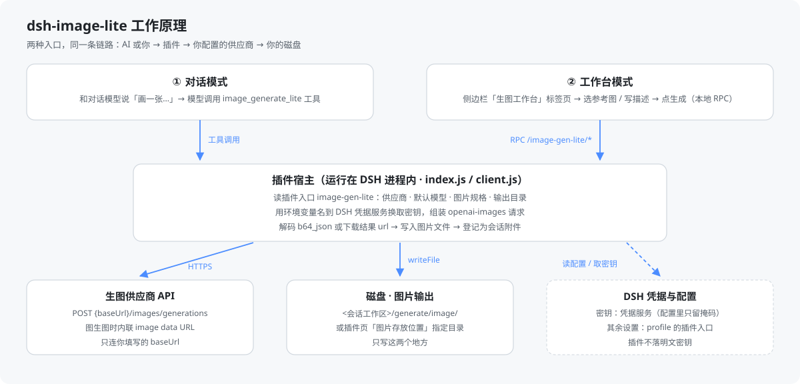
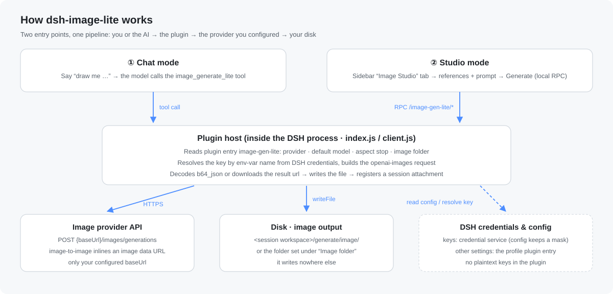

# dsh-image-lite

**中文** | [English](#english)

DSH 生图插件支持**双模式生图**：

- **对话模式**：直接和对话模型说"画一张…"，模型调用 `image_generate_lite` 工具
  把图生出来；说"改这张 / 参考刚才那张"时自动带参考图，支持链式图生图。
- **工作台模式**：在侧边栏「生图工作台」里手动处理生图任务——挑参考图、换模型与
  比例、写描述、出图后继续迭代，全程不占对话轮次。

两种模式共用同一份模型库与快速配置（插件入口 `image-gen-lite`，volatile 热生效），
自包含、无外部依赖，密钥经 DSH 核心凭据服务解析。

> **环境要求**：DSH `>= 0.2.1-rc.2`，Node.js `^22.19.0 || >= 24.0.0`（随宿主）。
> 低于该版本的 DSH 不保证可用：本插件依赖的 `configForms`、右栏标签注册等接口在 0.2.1 系列才稳定。

## 两种生图模式

### 一、对话模式：让大模型直接生图

在任意会话里说"画一张/出个图/来张 16:9 的"，对话模型会自动调用
`image_generate_lite`：

- 不带参考图 → 文生图；
- 说"把这张改成…/参考刚才那张" → 带 `referenceImages` 图生图；
- 结果文本内嵌 refs JSON，下一轮可以继续"用这张继续"，链式迭代不断档。

### 二、工作台模式：侧边栏「生图工作台」

会话 header 的「生图」角标（或右栏引导卡片）打开右栏 tab：

- 参考图：本会话最近结果「用这张继续」/ 上传 / 粘贴（经 attachment admission）；
- 换模型、选比例——**实时调整**，写入同一入口，热生效；
- 描述 → 生成 → 结果图库 + 灯箱 → 选中结果继续迭代；
- 右上角红色「清空」一键复位参考图、描述与结果。

### 共用配置：插件页 → dsh-image-lite → 插件配置（`plugins.bundle.config` 卡片）

- **模型库**：增删改供应商/模型（name / baseUrl / 接口格式 / 密钥环境变量 /
  模型列表，每行 `id` 或 `id  显示名`）。
- **快速配置**：默认模型 + 默认图片规格（7 档比例 + auto），
  下一次 `image_generate_lite` 调用即生效。
- **图片存放位置**：留空即 `<会话工作区>/generate/image`，也可填绝对路径，
  并可用「打开文件夹」调用系统选择器。
- **侧边栏 · 在侧边栏中使用生图工作台**（开关，默认开）：关闭立即隐藏
  右栏「生图工作」标签、它的引导卡片与会话 header 的「生图」按钮
  （`image_generate_lite` 工具不受影响）；重新开启后刷新窗口即恢复。

**这些设置存在哪里**

| 内容 | 存放位置 |
| --- | --- |
| 模型库（供应商、模型列表）、默认模型、默认图片规格、图片存放位置、侧边栏开关 | DSH profile 配置里的插件入口 `image-gen-lite`（本机实测落盘为 `~/.dsh/profiles/<profile>/cordis.patch.yml` 的 `image-gen-lite` 段，volatile 热生效） |
| API 密钥 | DSH 凭据服务，按环境变量名索引（本机实测为 `~/.dsh/.credentials.yaml`，权限由 DSH 管理）；插件配置里只留变量名与掩码，如 `IMAGE_GEN_AGNES_API_KEY` / `sk-m****0RPD` |
| 生成的图片 | `<会话工作区>/generate/image/`，或你在「图片存放位置」里指定的目录 |

也就是说：**换台机器只要带上 profile 配置与凭据存储，模型库和密钥就跟着走**；这两处都不在本插件目录里，卸载插件不会删掉它们。

## 工作原理



两种入口共用同一条链路，插件本体只做四件事：**读设置 → 换密钥 → 发一次请求 → 把图存下来**。

1. **入口**：对话模式由对话模型调用工具 `image_generate_lite`；工作台模式由客户端通过
   本地 RPC（挂在 DSH 现有 web server 的 `/image-gen-lite/*` 前缀下，受 DSH 自身登录令牌保护）
   请求同一套逻辑。
2. **读设置**：从插件入口 `image-gen-lite` 取供应商 `baseUrl`、`apiFormat`、默认模型与图片规格、
   输出目录、侧边栏开关；这些值存在 profile 配置里，改完下一次调用即生效（volatile）。
3. **换密钥**：配置里只有环境变量名（如 `IMAGE_GEN_AGNES_API_KEY`）和掩码，
   真正的密钥由 DSH 凭据服务按名字解析，插件进程里不落明文、不写日志。
4. **发请求**：按 openai-images 约定向 `{baseUrl}/images/generations` 发一次 HTTPS；
   图生图时把参考图内联成 `image` data URL 放在同一个请求里（本机实测该供应商只支持这种写法）。
5. **取回并落盘**：响应里的 `b64_json` 直接解码，或者按返回的 `url` 下载一次；
   随后 `mkdir -p` 输出目录并写文件，再登记进会话附件——所以下一轮能"用这张继续"。

## 权限与文件边界

| 类别 | 具体行为 |
| --- | --- |
| **读** | ① 插件入口 `image-gen-lite` 的配置；② 你在会话里显式传入的参考图附件（`attachments.readImage`，只认传进来的图）；③ 已生成的图片文件——**路径白名单**：仅 `<会话工作区>/generate/image` 与你在插件页「图片存放位置」里填的目录，越界一律报 `path is not a generated image file` |
| **写** | ① 图片：`mkdir -p` 输出目录后写 `lite-image-<时间戳>-<随机>.png`（按实际 MIME 取扩展名）；② 配置：经 DSH 配置表单写 profile 里的插件入口（本机实测落盘为 `~/.dsh/profiles/<profile>/cordis.patch.yml` 的 `image-gen-lite` 段）；③ 密钥：经 DSH 凭据服务写入（本机为 `~/.dsh/.credentials.yaml`），插件配置里只保留 `sk-m****0RPD` 这样的掩码 |
| **网络** | 只有两个出口：你配置的供应商 `baseUrl`（如 `https://api.agnes-ai.cn/v1`），以及供应商返回结果图的那个 URL（通常同域名）。没有遥测、没有第三方上报、不访问其它站点、不新开监听端口 |
| **不做** | 不执行 shell 命令、不遍历或上传工作区其它文件、不改 DSH 源码、不安装额外依赖（`package.json` 里除 DSH 自带包外无 runtime 依赖）、不常驻后台任务 |

一句话：**只读你显式给它的图，只写你指定的目录，只连你配置的域名。**

> 卸载插件不会删除已生成的图片与已存进凭据服务的密钥；要彻底清理，删除
> profile 配置里的 `image-gen-lite` 段、凭据里的对应环境变量名，以及你指定的输出目录。

## 安装

需要 DSH `>= 0.2.1-rc.2`（Node.js `^22.19.0 || >= 24.0.0`，随宿主提供）。

### 方式一：从 npm 安装（推荐）

```powershell
# 从 npm registry 安装到 desktop profile：
dsh plugin --profile desktop add dsh-image-lite
```

版本、文件清单与发布记录见 <https://www.npmjs.com/package/dsh-image-lite>。由仓库内 `.github/workflows/release.yml`（GitHub OIDC）发布的版本会额外附带 `provenance` 溯源证明；`0.1.0` 是本地 `npm publish` 发布的，暂无该证明。

### 方式二：从本地源码安装（开发 / 改代码时）

```powershell
# 从 DSH 桌面端 CLI / 插件页安装本地包（link: 方式）：
dsh plugin --profile desktop add link:D:\path\to\dsh-image-lite
```

两种方式装的是同一个插件，包内 `cordis.patch.yml` 会自动挂载 `image-gen-lite` 入口，**不需要手改 profile 配置**。区别只有一点：`link:` 方式指向源码目录，改完代码刷新窗口即可生效；npm 方式装的是发布快照，升级靠重新执行 `add`。

重启 DSH（或 HMR 生效时自动重组合）后：

1. 插件页 → dsh-image-lite：添加供应商/模型、粘贴密钥，选默认模型与规格；
2. **对话模式**：在会话里说"画一张…"即自动调用 `image_generate_lite`；
3. **工作台模式**：会话 header 出现「生图」角标，点开即右栏「生图工作」tab
   （插件页该卡片里的「侧边栏」开关可把它连同角标一起关掉）。

密钥直接在 插件页 → dsh-image-lite 的供应商卡片里粘贴（存进 DSH 凭据服务，配置里只留环境变量名与掩码，如 `IMAGE_GEN_AGNES_API_KEY` / `sk-0****7890`）。

## 开发

```bash
node test/wire.test.js           # 纯函数单测（比例映射/回退、wire 体、refs 校验）
node test/client-wiring.test.js  # client 接线 + 模型库纯函数
```

测试不需要任何外部服务或密钥；`index.js` / `client.js` / `wire.js` 三个入口的分工见源码顶部注释。

---

## English

[中文](#dsh-image-lite) | **English**

`dsh-image-lite` is an image-generation plugin for [DeepSeek Harness](https://github.com/deepseek-ai) (DSH) with **two ways to generate**:

- **Chat mode** — just tell the chat model "draw me …". The model calls the
  `image_generate_lite` tool for you; say "change this one" / "use the previous image"
  and it passes reference images automatically, so you can iterate in a chain.
- **Studio mode** — do the work by hand in the **Image Studio** tab of the right
  sidebar: pick references, switch model and aspect ratio, write the prompt, then keep
  iterating on the gallery. It never consumes a chat turn.

Both modes share one model library and one set of defaults (plugin entry
`image-gen-lite`, volatile / hot-reloaded). The plugin is self-contained with no
runtime dependencies, and API keys are resolved through DSH's credential service.

> **Requirements**: DSH `>= 0.2.1-rc.2`, Node.js `^22.19.0 || >= 24.0.0` (provided by the host).
> Older DSH builds are not supported: the `configForms` and right-sidebar tab APIs this plugin
> relies on only settled in the 0.2.1 series.

### The two modes

**1. Chat mode — let the model generate**

Say "draw a picture", "make an image", "a 16:9 shot of …" in any conversation; the
model calls `image_generate_lite`:

- no references → text-to-image;
- "change this one" / "reference the previous image" → image-to-image via `referenceImages`;
- each result carries a refs JSON line, so the next turn can continue from it.

**2. Studio mode — the sidebar Image Studio**

Open the right-hand tab from the 「生图」 button in the session header (or the guide card):

- references: reuse the latest result in this session, upload, or paste (through
  attachment admission);
- switch model and aspect ratio — **live**, written to the same entry and hot-reloaded;
- prompt → generate → gallery + lightbox → pick a result and keep editing;
- the red **Clear** button at the top-right resets references, prompt and results at once.

**Shared settings — Plugins page → dsh-image-lite → plugin config**
(the `plugins.bundle.config` card)

- **Model library**: add / edit / remove providers and models (name, baseUrl, API
  format, key env var, model list — one `id` or `id  display name` per line).
- **Quick config**: default model + default aspect stop (7 ratios + auto), used by the
  next `image_generate_lite` call.
- **Image folder**: empty means `<session workspace>/generate/image`; an absolute path
  is also accepted, and the "Open folder…" button opens the native directory picker.
- **Sidebar · use the studio in the sidebar** (switch, on by default): turning it off
  hides the 生图工作 tab, its guide card and the header button immediately
  (`image_generate_lite` keeps working); turning it back on restores them after a
  window refresh.

**Where these settings live**

| What | Where |
| --- | --- |
| Model library, default model, default aspect, image folder, sidebar switch | The plugin entry `image-gen-lite` in the DSH profile config (observed on this machine as the `image-gen-lite` section of `~/.dsh/profiles/<profile>/cordis.patch.yml`; volatile, hot-reloaded) |
| API keys | DSH credential service, indexed by env-var name (observed as `~/.dsh/.credentials.yaml`, managed by DSH); the plugin config only keeps the env-var name and a mask such as `IMAGE_GEN_AGNES_API_KEY` / `sk-m****0RPD` |
| Generated images | `<session workspace>/generate/image/`, or the folder you set under Image folder |

In other words: **move the profile config and the credential store to another machine
and the model library and keys come along** — neither lives in the plugin directory,
and uninstalling the plugin will not delete them.

### How it works



Both entry points share one pipeline; the plugin itself only does four things:
**read settings → resolve the key → send one request → save the image**.

1. **Entry**: chat mode calls the tool `image_generate_lite`; studio mode calls the same
   logic over a local RPC (mounted under `/image-gen-lite/*` on DSH's existing web
   server, protected by DSH's own session token).
2. **Read settings**: `baseUrl`, `apiFormat`, default model, aspect stop, output folder
   and the sidebar switch come from the plugin entry `image-gen-lite`, stored in the
   profile config — changes apply to the next call (volatile).
3. **Resolve the key**: the config only holds the env-var name (e.g.
   `IMAGE_GEN_AGNES_API_KEY`) and a mask; the real secret is resolved by name from the
   DSH credential service. The plugin never writes plaintext keys or logs them.
4. **Send**: one HTTPS request to `{baseUrl}/images/generations` following the
   openai-images convention; for image-to-image the reference is inlined as an `image`
   data URL in that same request.
5. **Fetch and save**: decode `b64_json` from the response, or download the returned
   `url` once; then `mkdir -p` the output folder, write the file and register it as a
   session attachment — which is why "use this one" works on the next turn.

### Permissions and file boundaries

| Aspect | Actual behaviour |
| --- | --- |
| **Reads** | (1) the config of the plugin entry `image-gen-lite`; (2) reference-image attachments you explicitly pass in a session (`attachments.readImage`); (3) already generated image files — **path allow-list**: only `<session workspace>/generate/image` and the folder set under Image folder; anything else fails with `path is not a generated image file` |
| **Writes** | (1) images: `mkdir -p` the output folder, then write `lite-image-<timestamp>-<random>.png` (extension from the actual MIME type); (2) config: through DSH's config form into the plugin entry in the profile config; (3) API keys: through DSH's credential service — the plugin config keeps only a mask such as `sk-m****0RPD` |
| **Network** | Exactly two destinations: the provider `baseUrl` you configured (e.g. `https://api.agnes-ai.cn/v1`), and the URL the provider returns for the result image (usually the same host). No telemetry, no third-party reporting, no other hosts, no listening ports |
| **Never** | No shell commands, no walking or uploading other workspace files, no patching DSH itself, no extra dependencies (the `package.json` has no runtime dependencies beyond DSH's own packages), no background daemons |

In one line: **it reads only the images you hand it, writes only the folder you choose,
and talks only to the domain you configured.**

> Uninstalling the plugin does not delete generated images or keys already stored in the
> credential service. To clean up completely, remove the `image-gen-lite` section from
> the profile config, the matching env-var entry from the credential store, and your
> output folder.

### Install

Requires DSH `>= 0.2.1-rc.2` (Node.js `^22.19.0 || >= 24.0.0`, supplied by the host).

**Option 1 — from npm (recommended):**

```powershell
# Install into the desktop profile straight from the npm registry:
dsh plugin --profile desktop add dsh-image-lite
```

Versions, file list and publish records are visible at <https://www.npmjs.com/package/dsh-image-lite>.
Releases produced by `.github/workflows/release.yml` (GitHub OIDC) additionally carry
`provenance` attestations; `0.1.0` was published locally with `npm publish` and has none.

**Option 2 — from a local checkout (for development):**

```powershell
# Install the local package from the DSH desktop CLI or the Plugins page (link:):
dsh plugin --profile desktop add link:D:\path\to\dsh-image-lite
```

Both routes install the same plugin; its bundled `cordis.patch.yml` mounts the
`image-gen-lite` entry automatically, so **no profile config editing is needed**. The only
difference: `link:` points at your source tree (edit, refresh the window, done), while the
npm route installs a released snapshot (upgrade by running `add` again).

After restarting DSH (or once HMR regroups the bundle):

1. Plugins page → dsh-image-lite: add a provider/model, paste the key, pick the default
   model and aspect stop;
2. **Chat mode**: say "draw me …" in a conversation — `image_generate_lite` is called
   automatically;
3. **Studio mode**: the 「生图」 button appears in the session header; clicking it opens
   the 生图工作 tab in the right sidebar (the sidebar switch on the same card can hide
   both).

Paste the key directly into the provider card on the Plugins page: it goes into DSH's
credential service and the config only keeps the env-var name and a mask such as
`IMAGE_GEN_AGNES_API_KEY` / `sk-0****7890`.

### Development

```bash
node test/wire.test.js           # pure helpers (aspect fallback, wire bodies, ref validation)
node test/client-wiring.test.js  # client wiring + model-library helpers
```

The tests need no network, keys or external services. The roles of `index.js`,
`client.js` and `wire.js` are documented at the top of each file.
